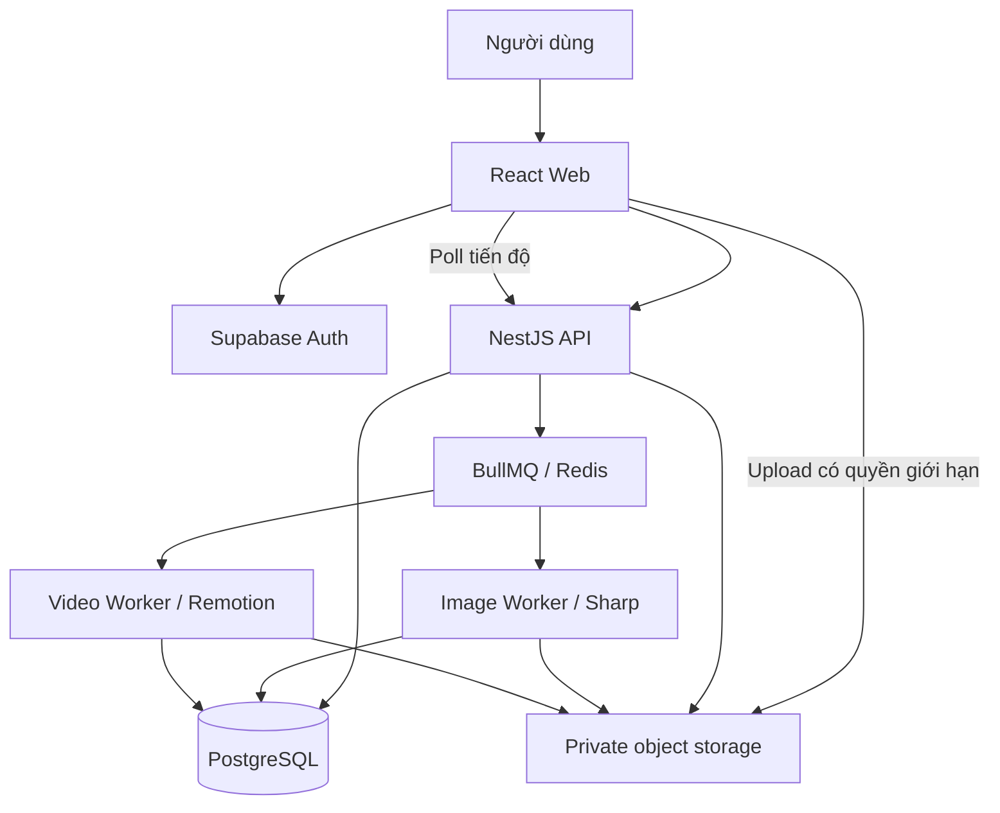

# Kế hoạch triển khai Couple Scrapbook

> Phiên bản kế hoạch: 1.1 · Ngày lập: 28/10/2026 · Cập nhật: 29/10/2026 · Trạng thái: MVP local đã triển khai; phần production còn tiếp tục.
>
> Tài liệu này là đề xuất kỹ thuật cho một ứng dụng web tạo scrapbook cặp đôi, tùy chỉnh layout và xuất video recap. Các lựa chọn mặc định bên dưới giúp bắt đầu triển khai; không đồng nghĩa dịch vụ cloud đã được đăng ký hay sản phẩm đã hoàn thành.

> Tiến độ thực tế và khác biệt so với kiến trúc đích được cập nhật tại [IMPLEMENTATION_STATUS.md](IMPLEMENTATION_STATUS.md). Đã có editor nhóm/lớp/mẫu cá nhân, video với nhạc riêng và thời lượng cảnh, lịch sử server 50 revision và backup/restore database + media. Xem [BACKUP_RESTORE.md](BACKUP_RESTORE.md) để vận hành khôi phục. Checklist các giai đoạn bên dưới giữ phạm vi kiến trúc đích, chưa được đánh dấu lại đầy đủ.

## 1. Mục tiêu và kết quả đầu ra

Người dùng có thể tạo album cho cặp đôi, nhập ngày bắt đầu và các kỉ niệm, tải ảnh, viết lời nhắn, chọn mẫu scrapbook, tùy chỉnh từng trang rồi xuất video ngắn từ chính nội dung đã lưu.

Luồng sản phẩm cốt lõi:

```text
Đăng nhập → Tạo album → Thêm kỉ niệm và ảnh → Chọn template
→ Chỉnh layout → Lưu → Xem album → Chọn cảnh → Preview video → Xuất MP4
```

Mốc hoàn chỉnh đầu tiên: người dùng tải 5 ảnh, nhập ngày yêu nhau và lời nhắn, tự bố trí một trang scrapbook; tải lại trang vẫn giữ nguyên và xuất được video dọc 30 giây.

### 1.1. Nguyên tắc

- Nội dung và layout được lưu thành dữ liệu có kiểu, có phiên bản; không chỉ lưu ảnh chụp màn hình.
- Web, editor và video dùng chung dữ liệu album, asset và token thiết kế; có renderer riêng cho từng môi trường.
- Người dùng luôn có thể sửa layout sau khi chọn template.
- Ảnh và album mặc định riêng tư. Chia sẻ là hành động chủ động của chủ album.
- Mỗi lần xuất video dùng một snapshot bất biến để sửa album không làm thay đổi tác vụ đang chạy.
- Ưu tiên một luồng end-to-end hoạt động thật trước khi tăng số template và hiệu ứng.
- Giao diện và font phải hiển thị tiếng Việt đầy đủ.

## 2. Phạm vi sản phẩm

### 2.1. MVP bắt buộc

| Nhóm | Chức năng |
| --- | --- |
| Tài khoản | Đăng nhập bằng email magic link; phiên đăng nhập; đăng xuất |
| Album | Tạo, sửa, liệt kê, lưu trữ và xóa album có xác nhận |
| Cặp đôi | Tên hiển thị, ngày bắt đầu, ảnh đại diện, múi giờ |
| Kỉ niệm | Tiêu đề, ngày, lời nhắn, ảnh, loại sự kiện, đánh dấu nổi bật |
| Ngày động | Số ngày bên nhau, kỉ niệm hằng năm, mốc theo số ngày, sự kiện một lần |
| Media | Upload nhiều ảnh, tiến độ, thông báo lỗi, thumbnail, ảnh tối ưu |
| Scrapbook | 3 template hoàn thiện khi phát hành MVP |
| Editor | Thêm/xóa ảnh, text, sticker; kéo, xoay, resize, crop; đổi màu và font |
| Bố cục | Thứ tự lớp, khóa phần tử, căn giữa, snap cơ bản, nhân bản phần tử/trang |
| Lịch sử | Undo/redo trong phiên; tự lưu; tải lại khôi phục dữ liệu |
| Viewer | Album responsive, chuyển trang, xem ảnh lớn, mở thư |
| Video | Chọn nội dung, thứ tự cảnh, thời lượng 15–60 giây; nhạc tùy chọn; preview và xuất MP4 dọc |
| Tác vụ | Trạng thái chờ/chạy/thành công/thất bại, tiến độ, thử lại có kiểm soát |
| Chia sẻ | Link xem album chỉ đọc, có thể thu hồi |

### 2.2. Giới hạn ban đầu đề xuất

Các giới hạn được cấu hình ở server và hiển thị rõ tại UI; điều chỉnh sau khi đo thực tế.

- Tối đa 20 trang/album, 50 phần tử/trang.
- Tối đa 100 ảnh/album; mỗi ảnh tối đa 20 MB và 40 megapixel sau khi đọc metadata.
- Định dạng ảnh đầu vào: JPEG, PNG, WebP. HEIC và GIF động để sau.
- Text thuần có định dạng giới hạn; không cho nhập HTML, JavaScript hoặc CSS tùy ý.
- Sticker từ thư viện kiểm soát sẵn. SVG do người dùng tải lên chưa hỗ trợ.
- Video MVP: 9:16, 1080 × 1920, 30 fps; preset 15/30/60 giây.
- Preview chất lượng thấp hơn bản xuất; đặt giới hạn dung lượng nhạc và độ dài khi triển khai upload audio.
- Một tác vụ render đang hoạt động/người dùng; giới hạn toàn hệ thống theo tài nguyên worker.
- Editor desktop đầy đủ; mobile có thay ảnh, sửa chữ, chỉnh vị trí cơ bản và preview.

### 2.3. Ngoài MVP

- Cộng tác thời gian thực, con trỏ nhiều người, CRDT.
- AI tự viết lời dẫn, chọn ảnh, nhận diện khuôn mặt, tạo ảnh hoặc giọng đọc.
- Video nguồn do người dùng upload, dựng phim nhiều track chuyên nghiệp.
- Marketplace template, thanh toán, subscription và tên miền tùy chỉnh.
- Import HTML/template bên ngoài, plugin do người dùng viết.
- Xuất 4K, 1:1, 16:9 và tự bố trí hoàn toàn cho mọi tỉ lệ.
- Chỉnh sửa toàn bộ editor trên điện thoại ở mức tương đương desktop.
- Nhắc kỉ niệm qua email/push và lịch âm.

## 3. Các màn hình và luồng chính

### 3.1. Danh sách màn hình

1. Đăng nhập và xử lý magic link.
2. Dashboard album: tạo mới, mở gần đây, trạng thái xuất gần nhất.
3. Thiết lập album: tên hai người, ngày bắt đầu, múi giờ, tiêu đề.
4. Thư viện kỉ niệm: danh sách theo ngày, form thêm/sửa, lọc nổi bật.
5. Thư viện media: upload, chọn ảnh, kiểm tra ảnh đang xử lý hoặc lỗi.
6. Chọn template: thumbnail, xem trước, mô tả nội dung có thể chỉnh.
7. Editor: thanh công cụ, danh sách trang, canvas, bảng thuộc tính, trạng thái lưu.
8. Viewer album: bìa, các trang, timeline, bộ đếm, lightbox và thư.
9. Video builder: chọn cảnh, sắp thứ tự, thời lượng, nhạc, preview.
10. Export: tiến độ, lỗi có hướng xử lý, tải kết quả và tạo lại.
11. Chia sẻ: tạo link, sao chép, thu hồi và thông báo phạm vi truy cập.

### 3.2. Trạng thái cần thiết

- Empty state có thao tác tiếp theo: chưa có ảnh, kỉ niệm, trang hoặc video.
- Loading/skeleton; upload đang chạy; ảnh đang tối ưu.
- Lưu cục bộ/đang lưu/đã lưu/lỗi lưu/xung đột phiên bản.
- Asset mất hoặc chưa sẵn sàng: hiển thị placeholder trong editor, chặn xuất khi thiếu bắt buộc.
- Không có quyền; link đã thu hồi; album đã xóa.
- Render thất bại hoặc bị hủy: giữ dữ liệu cấu hình để người dùng sửa và chạy lại.

## 4. Kiến trúc kỹ thuật

### 4.1. Stack mặc định

| Lớp | Công nghệ đề xuất | Trách nhiệm |
| --- | --- | --- |
| Web | React + TypeScript + Vite | Dashboard, editor, viewer, video builder |
| Style | Tailwind CSS và CSS variables | Layout ứng dụng, token thiết kế, responsive |
| Editor canvas | React Konva/Konva | Tương tác hình ảnh, chữ, sticker và transform |
| Hiệu ứng web | Motion | Chuyển trang, lightbox, phong bì, phản hồi thao tác |
| State editor | Zustand + command history | Selection, trang hiện tại, thay đổi và undo/redo |
| Server state | TanStack Query | Query, mutation, cache, polling trạng thái tác vụ |
| Validation | Zod cho schema dùng chung | Kiểm tra document, request, snapshot |
| API | NestJS + TypeScript | Quyền truy cập, dữ liệu, upload, versioning, export |
| Database | PostgreSQL + Prisma | Metadata và document JSONB có revision |
| Auth | Supabase Auth | Email magic link; API xác minh token |
| Object storage | Supabase Storage private bucket | Ảnh gốc, ảnh dẫn xuất, audio, MP4 |
| Xử lý ảnh | Sharp | Xoay theo EXIF, resize, thumbnail, encode |
| Queue | BullMQ + Redis | Điều phối tác vụ ảnh/video, retry và concurrency |
| Video | Remotion + renderer phía server | Preview composition và render MP4 |
| Đóng gói | pnpm workspace, Docker Compose | Monorepo, môi trường local, image triển khai |

Phiên bản package phải được xác minh về tương thích khi khởi tạo và khóa trong lockfile. Chỉ dùng quy tắc Next.js nếu sau này chọn chuyển sang Next.js.

### 4.2. Sơ đồ



API trả kết quả tạo tác vụ sớm; xử lý ảnh và video không giữ HTTP request chờ hoàn thành. Worker video chạy trong môi trường Node/container có Chromium, font và tài nguyên phù hợp. Chưa cần Lambda cho MVP.

### 4.3. Cấu trúc repository

```text
apps/
  web/                     # UI, editor, viewer, video builder
  api/                     # NestJS modules và HTTP API
  worker/                  # Image/video processors và lifecycle job
packages/
  domain/                  # TypeScript types, Zod schemas, recurrence
  design-tokens/           # Palette, font registry, shadow, texture
  document-engine/         # Layout model, commands, migrations, validation
  scrapbook-renderer/      # DOM renderer cho viewer, phần hình ảnh dùng chung
  video/                   # Remotion compositions và frame animations
  template-library/        # Template JSON và asset manifest
  config/                  # ESLint, TS config và cấu hình dùng chung
infra/
  docker/                  # Dockerfiles cho API và worker
  compose.yaml             # Postgres, Redis, local services khi cần
docs/
  architecture.md
  document-schema.md
  api-contract.md
  operations.md
```

Không lưu ảnh người dùng trong Git. Không đưa secret hoặc service-role key vào bundle frontend.

## 5. Mô hình dữ liệu

### 5.1. Các bảng chính

| Bảng | Trường tiêu biểu | Ghi chú |
| --- | --- | --- |
| profiles | id, auth_user_id, display_name | Ánh xạ tài khoản auth |
| albums | id, owner_id, title, partner_names, relationship_start_date, timezone, status | Ngày bắt đầu lưu kiểu date |
| memories | id, album_id, title, event_date, body, featured, sort_order | Nội dung kỉ niệm |
| anniversary_rules | id, album_id, kind, anchor_date, day_offset, leap_policy | Quy tắc ngày động |
| assets | id, album_id, owner_id, kind, object_key, mime, bytes, width, height, status | Metadata; không lưu binary trong DB |
| asset_variants | id, asset_id, variant, object_key, width, height, bytes | Thumbnail, editor, render |
| memory_assets | memory_id, asset_id, sort_order | Liên kết ảnh vào kỉ niệm |
| scrapbook_documents | id, album_id, schema_version, revision, document_json | Document layout và trang |
| document_revisions | id, document_id, revision, snapshot_json, created_at | Checkpoint giới hạn, không lưu mỗi pixel drag |
| video_projects | id, album_id, revision, config_json | Cảnh, nhạc và thời lượng |
| export_jobs | id, owner_id, album_id, snapshot_id, status, progress, error_code, output_key | Không đưa thông tin lỗi nội bộ ra UI |
| export_snapshots | id, schema_version, content_json, asset_manifest, content_hash | Bất biến sau khi tạo |
| share_links | id, album_id, token_hash, expires_at, revoked_at | Chỉ đọc; không dùng ID album làm quyền truy cập |

Tạo index cho owner_id, album_id, trạng thái job và thời gian tạo. Quan hệ FK và transaction phải bảo vệ tính nhất quán khi thêm/xóa nội dung.

### 5.2. Document schema

```ts
type ScrapbookDocument = {
  schemaVersion: 1;
  id: string;
  albumId: string;
  revision: number;
  themeId: string;
  pages: ScrapbookPage[];
};

type ScrapbookPage = {
  id: string;
  size: { width: number; height: number };
  background: { color: string; textureId?: string };
  elements: ScrapbookElement[]; // Thứ tự trong mảng xác định thứ tự lớp.
};

type ElementBase = {
  id: string;
  x: number;
  y: number;
  width: number;
  height: number;
  rotation: number;
  opacity: number;
  locked: boolean;
  animation?: {
    preset: 'none' | 'fade' | 'slide' | 'polaroid-drop' | 'typewriter';
    delayMs: number;
    durationMs: number;
  };
};

type ScrapbookElement = ElementBase & (
  | { type: 'image'; assetId: string; crop: CropRect; frameId: string }
  | { type: 'text'; text: string; style: TextStyle }
  | { type: 'sticker'; stickerId: string; tint?: string }
  | { type: 'anniversary'; ruleId: string; format: string; style: TextStyle }
);

// CropRect dùng tọa độ chuẩn hóa trong ảnh nguồn, mỗi trường từ 0 đến 1.
type CropRect = { x: number; y: number; width: number; height: number };
type TextStyle = {
  fontId: string;
  fontSize: number;
  color: string;
  align: 'left' | 'center' | 'right';
  lineHeight: number;
};
```

Quy tắc validation bổ sung: số hữu hạn, kích thước dương, opacity trong khoảng 0–1, crop nằm trong ảnh, ID phần tử duy nhất, font/sticker có trong registry và asset thuộc album. Không coi type TypeScript là thay thế validation runtime.

### 5.3. Tọa độ và tương thích renderer

- Layout lưu theo đơn vị thiết kế của trang, độc lập với pixel màn hình và zoom editor.
- Transform con trỏ từ màn hình về tọa độ thiết kế trước khi cập nhật dữ liệu.
- Resize kết thúc phải chuẩn hóa width/height và scale; không để scale tích lũy gây sai số.
- Viewer và video phải thống nhất font file, line-height, crop, border và shadow.
- Canvas và DOM có thể xuống dòng khác nhau: cần bộ mẫu đối chiếu text tiếng Việt, text dài và font trang trí trước khi cam kết độ khớp.
- Nếu cần giữ tuyệt đối hình thức một trang, cho phép rasterize lớp tĩnh của trang; giữ ảnh/text cần chuyển động thành lớp riêng.
- Có migration theo schemaVersion và fixture kiểm thử; document cũ không được tự mất nội dung khi mở.

## 6. Editor layout

### 6.1. Bố cục giao diện

- Trái: danh sách trang, template, media, text và sticker.
- Giữa: canvas, zoom, fit-to-screen, vùng ngoài trang.
- Phải: thuộc tính phần tử đang chọn; thuộc tính trang khi không chọn phần tử.
- Trên: tên album, undo/redo, trạng thái lưu, preview và xuất video.

### 6.2. Thao tác

- Chọn một phần tử; click vùng trống để bỏ chọn.
- Drag, resize bằng handle, xoay; giữ tỉ lệ ảnh mặc định.
- Crop ảnh trong khung thay vì làm méo ảnh.
- Double click text để nhập bằng textarea DOM phủ lên canvas; hỗ trợ bộ gõ tiếng Việt.
- Đưa lên trước/xuống sau, khóa, nhân bản và xóa.
- Căn giữa trang; đường gợi ý snap và khoảng cách snap phụ thuộc mức zoom.
- Phím tắt desktop: undo/redo, delete khi không nhập text, di chuyển bằng phím mũi tên.
- Mỗi thao tác cũng có nút hoặc input thuộc tính để không phụ thuộc kéo thả.
- Multi-select và group là giai đoạn bổ sung sau editor cơ bản nếu còn đủ thời gian.

### 6.3. Undo/redo và tự lưu

- Lưu lịch sử bằng command hoặc patch theo thao tác hoàn chỉnh.
- Một lần drag/resize hoặc một phiên chỉnh text tương ứng một bước undo; không ghi mỗi pointermove.
- Undo/redo không chứa selection, zoom và trạng thái panel.
- Debounce autosave dự kiến 800–1.500 ms sau thao tác; không để nhiều request lưu cùng document chạy chồng.
- PATCH gửi expectedRevision; server tăng revision trong transaction.
- Revision lệch trả 409; UI giữ bản nháp và yêu cầu tải bản mới hoặc lưu thành bản sao. Không ghi đè âm thầm.
- Nếu thay đổi tiếp trong lúc đang lưu, gửi lần tiếp theo sau khi request trước hoàn thành với revision mới.
- Bản nháp khôi phục cục bộ lưu trong IndexedDB theo user/document; xóa khi đăng xuất theo chính sách sản phẩm.
- Cảnh báo khi rời trang còn dữ liệu chưa lưu; thao tác lưu thủ công luôn có sẵn.

## 7. Ngày kỉ niệm và dữ liệu động

Ba loại quy tắc:

1. `annual`: ngày bắt đầu yêu, sinh nhật, ngày cưới; lặp theo ngày/tháng.
2. `day-offset`: mốc 100, 365, 1.000 ngày tính từ anchor_date.
3. `one-time`: chuyến đi hoặc sự kiện cụ thể, không tự lặp.

Quy tắc mặc định:

- Ngày bắt đầu lưu YYYY-MM-DD, múi giờ album mặc định Asia/Ho_Chi_Minh.
- Số ngày đã trôi qua tính theo chênh lệch ngày lịch trong múi giờ album; ngày bắt đầu bằng 0 ngày đã trôi qua. Nếu hiển thị “ngày thứ”, giá trị là số đã trôi qua + 1.
- Mốc “sau 100 ngày” bằng anchor_date + 100 ngày; nhãn phải khớp quy ước.
- “1 năm” theo năm lịch, không thay bằng “365 ngày”.
- Với sự kiện 29/2, lưu leap_policy rõ ràng; mặc định dùng 28/2 trong năm không nhuận và thông báo tại phần thiết lập.
- Ngày bắt đầu trong tương lai hiển thị đếm ngược, không hiển thị số ngày yêu âm.
- Viewer tính lại khi qua nửa đêm tại múi giờ album và khi tab quay lại hoạt động; không cần render toàn album mỗi giây.
- Video cố định ngày tham chiếu và chuỗi hiển thị trong snapshot; render qua nửa đêm không làm cảnh thay đổi.

## 8. Backend và API

### 8.1. Module

`Auth`, `Albums`, `Memories`, `Anniversaries`, `Assets`, `Documents`, `Templates`, `VideoProjects`, `Exports`, `Sharing`, `Health`.

### 8.2. API dự kiến

Prefix `/api/v1`; mọi route ghi dữ liệu yêu cầu xác thực và kiểm tra quyền trên tài nguyên.

| Method | Endpoint | Ý nghĩa |
| --- | --- | --- |
| GET/POST | /albums | Liệt kê/tạo album |
| GET/PATCH/DELETE | /albums/:id | Đọc/sửa/xóa album |
| GET/POST | /albums/:id/memories | Danh sách/tạo kỉ niệm |
| PATCH/DELETE | /memories/:id | Sửa/xóa kỉ niệm |
| GET/POST | /albums/:id/anniversary-rules | Đọc/tạo quy tắc ngày |
| PATCH/DELETE | /anniversary-rules/:id | Sửa/xóa quy tắc ngày |
| POST | /albums/:id/assets/upload-intent | Xin quyền upload giới hạn |
| POST | /assets/:id/complete | Báo upload xong và yêu cầu kiểm tra file |
| GET | /albums/:id/assets | Liệt kê media và trạng thái |
| DELETE | /assets/:id | Xóa asset khi không bị tham chiếu |
| GET | /templates | Danh sách mẫu và phiên bản |
| GET/PATCH | /albums/:id/document | Đọc/lưu document với expectedRevision |
| POST | /albums/:id/document/checkpoints | Tạo checkpoint trước thay đổi lớn |
| GET/PUT | /albums/:id/video-project | Đọc/lưu cấu hình video với revision |
| POST | /albums/:id/exports | Tạo snapshot và tác vụ render; trả 202 |
| GET | /exports/:id | Trạng thái, tiến độ và lỗi đã chuẩn hóa |
| POST | /exports/:id/cancel | Yêu cầu hủy; worker kiểm tra khả năng hủy |
| GET | /exports/:id/download | Cấp URL tải ngắn hạn sau khi kiểm tra quyền |
| POST | /albums/:id/share-links | Tạo token chỉ đọc |
| DELETE | /share-links/:id | Thu hồi link |
| GET | /shared/:token | Dữ liệu viewer đã giới hạn theo link |
| GET | /health/live, /health/ready | Liveness/readiness |

### 8.3. Quy tắc vận hành API

- Pagination cho danh sách; giới hạn body, số phần tử và độ dài text.
- Mã lỗi ổn định như `ASSET_NOT_READY`, `REVISION_CONFLICT`, `RENDER_LIMIT_REACHED`.
- Log dùng requestId/jobId; không log token, signed URL hay toàn bộ lời nhắn riêng tư.
- Tạo export hỗ trợ idempotency key; request bị gửi lại không tạo nhiều tác vụ trùng.
- Snapshot tạo trong transaction với version được kiểm tra; enqueue qua outbox/reconciler để không mất job nếu Redis lỗi ngay sau commit.
- Xóa album đánh dấu trước, chặn tác vụ mới, sau đó cleanup file nền. Không cascade xóa asset đang được snapshot render giữ tham chiếu.

## 9. Pipeline ảnh và audio

### 9.1. Ảnh

1. API kiểm tra quyền, quota và tạo asset trạng thái `uploading` với object key do server sinh.
2. Client upload trực tiếp bằng quyền ngắn hạn, hiển thị tiến độ và có thao tác thử lại.
3. Client gọi complete; server kiểm tra file thực tồn tại, kích thước thực và nội dung định dạng.
4. Enqueue image job; Sharp đọc metadata với giới hạn pixel, xoay theo EXIF và tạo biến thể.
5. Tạo thumbnail khoảng 320 px, bản editor khoảng 1.600 px và bản phục vụ render phù hợp kích thước đầu ra; các giá trị được đo lại trước release.
6. Bản dẫn xuất không giữ EXIF vị trí. Ảnh gốc luôn riêng tư và chỉ giữ khi có nhu cầu phục hồi crop/render.
7. Ghi metadata và chuyển sang `ready`; lỗi chuyển `failed` kèm mã lỗi có thể hiểu được.

### 9.2. Audio

- Bản đầu hỗ trợ thư viện nhạc có quyền sử dụng rõ ràng; upload audio cá nhân thực hiện khi pipeline kiểm tra đã sẵn sàng.
- Lưu thời lượng, điểm bắt đầu, âm lượng và fade in/out trong cấu hình video.
- Kiểm tra file thực, codec và duration ở backend; không chỉ tin extension hoặc header client.
- Nếu nhạc ngắn hơn video, hành vi mặc định là fade out khi hết nhạc; loop chỉ khi người dùng chọn.
- Không tự đưa nhạc thương mại chưa có quyền sử dụng vào sản phẩm.

## 10. Pipeline video

### 10.1. Video project

Mỗi cảnh có `id`, nguồn page/memory, danh sách asset, nội dung text, preset chuyển động, durationFrames và layout dọc. Toàn video có fps, kích thước, soundtrack, tổng số frame và reference date.

- Bắt đầu với 4 kiểu cảnh: mở đầu, kỉ niệm một ảnh, collage, lời kết.
- Người dùng chủ động chọn cảnh; tính năng “tạo nhanh” lấy kỉ niệm nổi bật theo thời gian, vẫn cho sửa trước render.
- Mọi thời lượng được quy đổi thành số frame nguyên; tổng duration và phần overlap transition phải thống nhất.
- Trang scrapbook được mặc định đặt vừa trong khung video, giữ toàn bộ nội dung; muốn bố cục dọc đẹp hơn thì chọn mẫu chuyển đổi và chỉnh preview riêng.
- Đổi tỉ lệ hoặc đổi template không được phá layout gốc của album.

### 10.2. Preview và render

1. Web dùng Remotion Player cho preview; chỉ dùng asset đã sẵn sàng và URL có thời hạn đủ cho phiên xem.
2. Người dùng xác nhận xuất; server kiểm tra quyền, quota, revision, font, ảnh và audio.
3. Tạo snapshot bao gồm nội dung đã resolve, ngày tham chiếu, phiên bản template/font/effect và manifest asset.
4. Worker lấy snapshot, tải asset bằng quyền backend và staging local có giới hạn; không phụ thuộc signed URL sắp hết hạn giữa render.
5. Chờ font và ảnh sẵn sàng trước frame; không dùng Math.random(), Date.now() hoặc dữ liệu mạng thay đổi để quyết định hình ảnh mỗi frame.
6. Render composition bằng Remotion, mã hóa H.264/AAC nếu có audio, định dạng MP4.
7. Upload output, ghi metadata, đánh dấu `completed`; API cấp link tải có thời hạn.
8. Cleanup file tạm khi thành công, thất bại hoặc hủy; quy trình dọn định kỳ xử lý worker chết đột ngột.

### 10.3. Trạng thái và độ tin cậy

```text
queued → preparing → rendering → uploading → completed
                  ↘ failed
queued/preparing/rendering → cancel_requested → canceled (khi dừng an toàn)
```

- Progress gồm các pha; không hiển thị 100% trước khi output tải được.
- Retry có backoff chỉ với lỗi tạm thời; lỗi input/codec/font không retry vô hạn.
- Worker có timeout, heartbeat và concurrency mặc định 1 video/worker; tăng sau khi benchmark CPU/RAM.
- Retry cùng snapshot tạo kết quả nhất quán và không tạo nhiều bản output được đánh dấu thành công.
- Tác vụ đang chạy giữ tham chiếu asset; cleanup chỉ xóa khi không còn document/snapshot đang dùng.
- Giới hạn thời gian giữ output, snapshot và file gốc được cấu hình; hiển thị thời hạn tải cho người dùng trước khi áp dụng tự xóa.
- Hiệu ứng video chạy theo frame bằng API Remotion; Motion phục vụ tương tác web. Hai renderer dùng chung mô tả preset, không dùng chung clock animation.

## 11. Hệ thống thiết kế và template

### 11.1. Ba template MVP

| Template | Đặc điểm | Nội dung chính |
| --- | --- | --- |
| Nhật ký Polaroid | Ảnh viền trắng, băng dính, nét viết tay | Bìa, ảnh và lời nhắn ngắn |
| Thư gửi người thương | Giấy thư, phong bì, bố cục thoáng | Lời nhắn dài, một ảnh chủ đạo |
| Những ngày bên nhau | Timeline, vé kỉ niệm, dấu mốc | Các sự kiện theo thời gian |

### 11.2. Quy tắc

- Token cho màu, font, khoảng cách, shadow, frame và texture; mỗi template có manifest phiên bản.
- Tối đa hai họ font trong một theme; body dễ đọc, font viết tay dùng ở điểm nhấn.
- Texture không cản trở chữ; sticker không che thao tác quan trọng.
- Template phải có dữ liệu mẫu được gắn nhãn, không giả định đó là dữ liệu thật của người dùng.
- Nội dung text dài có giới hạn, cảnh báo tràn và cách chỉnh; không tự cắt mất lời nhắn.
- Kiểm tra UI ở 375/390, 768, 1.024 và 1.440 px; viewer không tràn ngang ngoài chủ ý.
- Tôn trọng reduced motion trên web; hiệu ứng xuất video có lựa chọn giảm chuyển động riêng.
- Viewer có nội dung semantic bằng DOM; editor canvas có bảng thuộc tính và nhãn hỗ trợ thao tác bàn phím.

## 12. Skill và tài liệu hướng dẫn AI

### 12.1. Skill dùng khi triển khai

| Skill | Nguồn | Thời điểm |
| --- | --- | --- |
| frontend-design | anthropics/skills | Thiết kế UI, template, token |
| vercel-react-best-practices | vercel-labs/agent-skills | Viết và review React |
| web-design-guidelines | vercel-labs/agent-skills | Review accessibility và UX |
| Motion AI Kit | motion.dev | Triển khai hiệu ứng web |
| remotion-best-practices | remotion-dev/skills | Composition, preview, render |

UI UX Pro Max là nguồn tham khảo khi chọn palette/font. GSAP chỉ bổ sung khi có hiệu ứng cụ thể vượt nhu cầu Motion; chưa cần cài mặc định.

### 12.2. Skill riêng cần tạo

- `couple-scrapbook-editor`: document schema, hệ tọa độ, command history, autosave, template và quy tắc renderer.
- `couple-scrapbook-backend`: ownership, upload intent/complete, revision conflict, snapshot, queue và cleanup.
- `couple-scrapbook-video`: cấu trúc cảnh, timing theo frame, mapping layout, font, audio và render job.

Tạo skill sau khi có schema và luồng chạy đầu tiên để hướng dẫn phản ánh implementation thật. Không cài nguồn bên ngoài chỉ vì trùng từ khóa; đọc nội dung và chọn phạm vi cài theo dự án.

## 13. Các giai đoạn triển khai

Ước lượng cho một lập trình viên full-time có hỗ trợ AI: khoảng 8–11 tuần làm việc. Đây là dự kiến, chưa phải cam kết; cần cập nhật sau giai đoạn thử nghiệm kỹ thuật. Không lấy thời gian AI sinh code làm thời gian hoàn thiện sản phẩm.

### Giai đoạn 0 — Khởi tạo và thử nghiệm kỹ thuật (3–4 ngày)

- [ ] Kiểm tra workspace, quy tắc dự án và source hiện có.
- [ ] Chốt phạm vi, giới hạn MVP, stack và quy ước đếm ngày.
- [ ] Kiểm tra phiên bản package, license Remotion và quyền dùng font/texture/nhạc theo mô hình sản phẩm.
- [ ] Tạo workspace, lint, typecheck, format, env example và Docker local.
- [ ] Làm một trang có ảnh crop, text tiếng Việt, sticker xoay bằng Konva.
- [ ] Render cùng dữ liệu bằng DOM và Remotion thành clip 5 giây.
- [ ] Đối chiếu font, xuống dòng, crop và shadow; ghi quyết định renderer.

Đầu ra: khung repository và bằng chứng editor → renderer → MP4 dùng được. Không tiếp tục mở rộng template nếu độ khớp chưa đạt.

### Giai đoạn 1 — Nền tảng dữ liệu và media (5–6 ngày)

- [ ] Database migration, auth, ownership và error contract.
- [ ] API album, memory, anniversary và schema domain.
- [ ] Upload intent/complete, private storage, image worker và asset states.
- [ ] Form tạo album, thư viện media và kỉ niệm hoạt động với API thật.
- [ ] Unit test recurrence và integration test quyền truy cập.

Nghiệm thu: người dùng tạo album, tải ảnh, thêm kỉ niệm, đăng xuất/đăng nhập lại vẫn thấy dữ liệu; tài khoản khác không truy cập được.

### Giai đoạn 2 — Editor cơ bản và lưu layout (8–10 ngày)

- [ ] Document engine, validator và template Polaroid đầu tiên.
- [ ] Canvas, zoom, selection, drag, resize, rotation và crop.
- [ ] Text editor hỗ trợ bộ gõ tiếng Việt; font registry; sticker.
- [ ] Thuộc tính, layer order, lock, duplicate, delete và căn giữa/snap cơ bản.
- [ ] Undo/redo theo thao tác, autosave, revision conflict và khôi phục bản nháp.
- [ ] Thêm/xóa/nhân bản/sắp xếp trang.

Nghiệm thu: bố trí 5 ảnh và text, undo/redo, tải lại giữ đúng dữ liệu; mở hai tab không ghi đè âm thầm.

### Giai đoạn 3 — Viewer và ngày động (4–5 ngày)

- [ ] DOM renderer, lightbox, thư và chuyển trang bằng Motion.
- [ ] Timeline, bộ đếm và các mốc động theo múi giờ album.
- [ ] Responsive viewer và nội dung semantic.
- [ ] Link chia sẻ chỉ đọc, thu hồi và quyền truy cập asset.

Nghiệm thu: xem được trên mobile, chữ rõ, reduced motion hoạt động; link thu hồi không truy cập tiếp bằng API.

### Giai đoạn 4 — Video recap end-to-end (7–9 ngày)

- [ ] Cấu hình 4 kiểu cảnh, thứ tự, thời lượng và soundtrack.
- [ ] Remotion Player preview, animation presets theo frame.
- [ ] Snapshot bất biến, export API, outbox/reconciler và queue.
- [ ] Worker render MP4, tiến độ, retry, cancel và cleanup.
- [ ] Download có quyền; xử lý asset missing/font/audio lỗi.
- [ ] Xuất thử 15/30/60 giây với dữ liệu thật trên worker triển khai.

Nghiệm thu: render thành công video 30 giây từ album đã chỉnh; sửa album trong lúc render không đổi nội dung output; tải MP4 phát được trên thiết bị mục tiêu.

### Giai đoạn 5 — Hoàn thiện MVP (5–7 ngày)

- [ ] Hoàn thiện hai template còn lại và preview template.
- [ ] Onboarding, empty/error states, trạng thái lưu và cảnh báo quota.
- [ ] Mobile chỉnh sửa cơ bản; kiểm tra font, contrast và bàn phím.
- [ ] Multi-select/group nếu các phần bắt buộc đã ổn định.
- [ ] Tối ưu ảnh, tải module editor/video khi cần và giảm render không cần thiết.
- [ ] Kiểm thử toàn luồng với dữ liệu tiếng Việt, ảnh dọc/ngang và nội dung dài.

Nghiệm thu: ba template đều chỉnh sửa/lưu/xuất được; không có thao tác UI hứa hẹn chức năng chưa được nối.

### Giai đoạn 6 — Triển khai và chạy thử (4–5 ngày)

- [ ] CI, staging, HTTPS, migration và worker healthcheck.
- [ ] Backup/restore thử, log/metrics và cảnh báo job lỗi.
- [ ] Chạy thử 3 tác vụ video chờ đồng thời với concurrency giới hạn.
- [ ] Đo thời gian và chi phí render; hiệu chỉnh quota, timeout, CPU/RAM.
- [ ] Kiểm tra bản build production và khả năng rollback.
- [ ] Pilot với 3–5 người dùng, sửa lỗi chặn luồng và tài liệu vận hành.

Nghiệm thu: một người mới có thể tạo album và tải video theo onboarding mà không cần sửa DB hoặc chạy lệnh thủ công.

### 13.1. Thứ tự phụ thuộc

```text
Thử renderer → Schema → Auth/media → Editor/lưu → Viewer
                            └──────────────→ Video scenes → Export worker
Editor + Viewer + Export → Template bổ sung → Staging → Pilot → Release
```

## 14. Chiến lược kiểm thử

### 14.1. Unit test cho logic có rủi ro

- Ngày bắt đầu, ngày tương lai, qua năm, năm nhuận, 29/2 và nửa đêm theo múi giờ.
- 1 năm khác 365 ngày; day-offset và nhãn “ngày thứ”.
- Validation/migration document, crop, tọa độ và ID không trùng.
- Command undo/redo; tổng số frame; overlap transition.

### 14.2. Integration test

- Auth/ownership: không đọc, sửa hoặc render asset của người khác.
- Upload sai định dạng, quá dung lượng/pixel và gọi complete lặp.
- Autosave expectedRevision và xung đột 409.
- Export idempotency, commit thành công nhưng enqueue lỗi, retry và worker bị dừng.
- Xóa album/asset khi đang render; link chia sẻ thu hồi.

### 14.3. End-to-end và kiểm tra hình ảnh

- Đăng nhập → album → upload → edit → reload → preview → export → download.
- Undo text/drag, upload lỗi, mất mạng khi lưu và khôi phục.
- So sánh mẫu cố định giữa editor, viewer và frame video; review trực quan với ngưỡng sai khác xác định sau thử nghiệm renderer.
- Kiểm tra chữ tiếng Việt có dấu, emoji nếu hỗ trợ, đoạn dài và text tràn.
- Test Chromium tự động; kiểm tra tay Safari/iOS và Chrome Android cho viewer, preview và playback MP4.
- Không yêu cầu byte MP4 giống hệt giữa các lần render; kiểm tra nội dung, frame, thời lượng và khả năng phát.

## 15. Hiệu năng và tiêu chí nghiệm thu tổng thể

Các số bên dưới là mục tiêu để đo, không phải số đã đạt.

| Chỉ tiêu | Mục tiêu ban đầu | Cách đo |
| --- | --- | --- |
| Viewer | LCP ≤ 2,5 giây ở fixture album và cấu hình mạng/thiết bị ghi rõ | Lighthouse + đo staging |
| Editor | Thao tác 30 phần tử/trang không giật kéo dài trên laptop tham chiếu | Performance trace và thử tay |
| Autosave | Dữ liệu được gửi trong khoảng 2 giây sau ngừng thao tác khi mạng bình thường | E2E + log request |
| Tính toàn vẹn | Reload giữ đúng phần tử, crop, text và thứ tự lớp | So sánh document và hình ảnh |
| Video | Xuất MP4 30 giây/1080p thành công trên worker staging | Smoke render; ghi thời gian/CPU/RAM |
| Render time | Chốt SLA sau benchmark, không giả định render thời gian thực | Bộ fixture 15/30/60 giây |
| Tải đồng thời | 3 job được xếp hàng đúng và không làm API mất phản hồi | Load smoke test |
| Quyền truy cập | Không đọc/ghi được tài nguyên album khác | Integration tests |

Definition of Done cho mỗi tính năng: UI và API nối thật; loading/empty/error có xử lý; validation và quyền truy cập đầy đủ; check phù hợp chạy qua; tài liệu thay đổi và giới hạn được cập nhật.

## 16. Triển khai, môi trường và vận hành

### 16.1. Môi trường

- Local: web, API, worker; Postgres/Redis qua Docker; dự án Supabase development hoặc local stack khi cần.
- Staging: auth/storage/database riêng với production; thử migration và render tại đây trước.
- Production: web static hosting; API và worker container tách tiến trình; Postgres và Redis có persistence phù hợp.
- Build worker cài cố định font, Chromium dependencies và các thành phần render cần thiết; không phụ thuộc font của máy lập trình viên.

### 16.2. CI/CD

1. Cài dependency theo lockfile.
2. Lint, typecheck, unit và integration tests phù hợp.
3. Build web/API/worker; kiểm tra schema/template hợp lệ.
4. E2E smoke và render video fixture ngắn trên môi trường hỗ trợ.
5. Deploy staging, chạy migration, smoke test.
6. Release production theo quy trình dự án; lưu image/tag trước để rollback.

Migration dùng cách mở rộng rồi chuyển đổi trước khi xóa trường cũ. Rollback app không mặc định hoàn tác được migration phá dữ liệu; tránh migration phá dữ liệu trong MVP.

### 16.3. Biến môi trường dự kiến

`DATABASE_URL`, `REDIS_URL`, `SUPABASE_URL`, `SUPABASE_PUBLISHABLE_KEY`, cấu hình xác minh JWT, secret backend cho storage, tên bucket, `APP_ORIGIN`, `API_ORIGIN`, giới hạn upload/render, thư mục staging và concurrency worker.

Chỉ public URL/key được thiết kế cho client mới có prefix `VITE_`. Tên key cụ thể phải khớp SDK/version khi triển khai. `.env.example` chỉ chứa placeholder.

### 16.4. Theo dõi và bảo trì

- Metrics: API error/latency, queue depth, job age, render duration, failures, worker RAM và dung lượng lưu trữ.
- Alert khi worker không heartbeat, queue chờ quá lâu, tỷ lệ render lỗi cao hoặc storage gần quota.
- Job dọn upload dở, staging mồ côi, output hết hạn và checkpoint vượt giới hạn.
- Backup DB định kỳ; object storage có chính sách phục hồi/retention riêng; thử restore trước release.
- Quy trình xóa tài khoản phải bao gồm DB, object storage, share token và render đang chạy; tài liệu giải thích thời gian xử lý.

## 17. Chi phí và giới hạn tài nguyên

Chưa đưa ra con số tiền cố định khi chưa chọn nhà cung cấp, khu vực và đo render. Theo dõi riêng:

| Hạng mục | Yếu tố chi phí | Cách kiểm soát |
| --- | --- | --- |
| Storage | Ảnh gốc, biến thể, nhạc, MP4 và backup | Quota, retention, cleanup có tham chiếu |
| Bandwidth | Xem album, preview và tải MP4 | Thumbnail, cache phù hợp quyền truy cập |
| Worker | CPU/RAM × thời gian render | Concurrency giới hạn, timeout, preset độ phân giải |
| Database/Redis | Dung lượng, kết nối và uptime | Index, pagination, giới hạn lịch sử/job |
| Auth/email | Email đăng nhập và người dùng hoạt động | Rate limit và cấu hình nhà cung cấp |
| License/media | Remotion theo mô hình sử dụng; quyền font/nhạc/texture | Kiểm tra trước khi thương mại hóa |

Sau benchmark, tính chi phí trung bình/video 30 giây và chi phí/album; dùng số này để đặt hạn mức export. Không cho retry tự động không giới hạn hoặc render ẩn mỗi lần sửa layout.

## 18. Rủi ro và cách xử lý

| Rủi ro | Ảnh hưởng | Phương án |
| --- | --- | --- |
| Canvas và DOM khác typography | Preview và MP4 không khớp | Thử sớm, dùng font cố định, thống nhất text metrics, rasterize lớp tĩnh khi cần |
| Layout tự do khó dùng trên mobile | Chữ/ảnh nhỏ, thao tác khó | Viewer scale theo trang; editor mobile giới hạn; mẫu dọc riêng |
| Video ăn CPU/RAM | Worker chết hoặc chi phí cao | Queue, benchmark, quota, concurrency thấp và timeout |
| Signed URL hết hạn | Render thiếu ảnh | Worker staging asset bằng quyền backend; refresh preview URL |
| Lưu hai tab | Mất thay đổi | Revision, 409 và giữ bản nháp |
| Xóa ảnh đang render | Video lỗi | Snapshot reference và cleanup trì hoãn |
| Font thiếu dấu hoặc text tràn | Sai nội dung | Registry kiểm tra tiếng Việt, preload và cảnh báo tràn |
| Người dùng kỳ vọng editor như Canva | Phạm vi phình to | Công bố thao tác MVP và giới hạn; hoàn thiện luồng trước |
| Mở rộng skill quá sớm | Quy tắc xa implementation | Tạo skill riêng sau schema và bản chạy đầu |

## 19. Checklist phát hành MVP

- [ ] Luồng tạo album → chỉnh layout → tải lại → xuất MP4 chạy với backend thật.
- [ ] Có 3 template, thay ảnh/chữ và sửa bố cục độc lập.
- [ ] Ngày động đúng múi giờ và quy ước được hiển thị rõ.
- [ ] Autosave, undo/redo và xung đột phiên bản không làm mất dữ liệu âm thầm.
- [ ] Upload sai file/quá giới hạn có thông báo và không chạy xử lý vô hạn.
- [ ] Preview và video khớp nội dung, crop, font và thứ tự cảnh.
- [ ] Video có progress, lỗi có thể xử lý, link tải hoạt động và quota áp dụng ở server.
- [ ] Album/ảnh riêng tư; chia sẻ chỉ đọc và thu hồi được.
- [ ] Font/texture/sticker/nhạc có nguồn và quyền sử dụng được ghi nhận.
- [ ] Kiểm tra điều kiện license Remotion cho cách vận hành thực tế.
- [ ] CI và smoke render production image chạy qua.
- [ ] Backup/restore, cleanup, logs và rollback đã thử.
- [ ] Pilot hoàn tất; lỗi chặn tạo/lưu/xuất đã xử lý.
- [ ] Tài liệu cài đặt local, biến môi trường, API và vận hành cập nhật.

## 20. Công việc bắt đầu ngay

1. Khởi tạo monorepo và các lệnh `dev`, `build`, `lint`, `typecheck`, `test`.
2. Viết schema document v1 và fixture một trang chứa 5 ảnh, text tiếng Việt, sticker, ngày động.
3. Dựng spike React Konva → DOM viewer → Remotion clip 5 giây.
4. Review hình ảnh đầu ra, chốt font/crop/text metrics và kiến trúc renderer.
5. Triển khai auth, database, upload ảnh và editor dựa trên schema đã kiểm chứng.

## 21. Tài liệu tham khảo

Các nguồn đã được tham khảo trong quá trình lập phương án; cần đọc lại API, phiên bản và điều kiện hiện hành khi triển khai.

- [Frontend Design skill](https://github.com/anthropics/skills/tree/main/skills/frontend-design)
- [Vercel Agent Skills](https://github.com/vercel-labs/agent-skills)
- [Motion for React](https://motion.dev/docs/react)
- [Motion AI Kit](https://motion.dev/docs/ai-kit)
- [React Konva](https://konvajs.org/docs/react/index.html)
- [NestJS](https://docs.nestjs.com/)
- [Sharp](https://sharp.pixelplumbing.com/)
- [BullMQ](https://docs.bullmq.io/)
- [Supabase Storage access control](https://supabase.com/docs/guides/storage/security/access-control)
- [Remotion Agent Skills](https://www.remotion.dev/docs/ai/skills)
- [Remotion animation](https://www.remotion.dev/docs/animating-properties)
- [Remotion server-side rendering](https://www.remotion.dev/docs/ssr)
- [Remotion license và pricing](https://www.remotion.dev/pricing)
